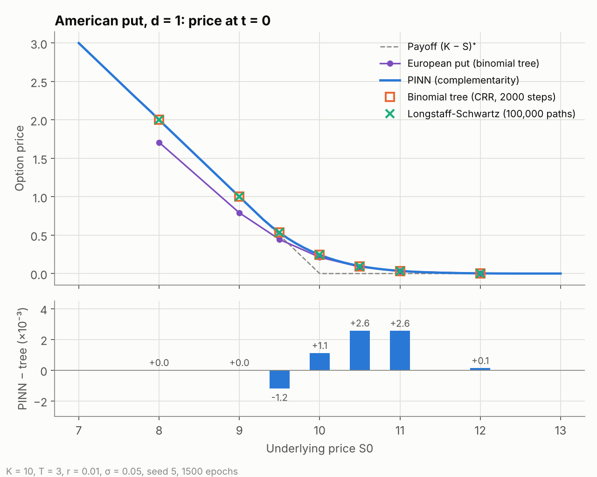
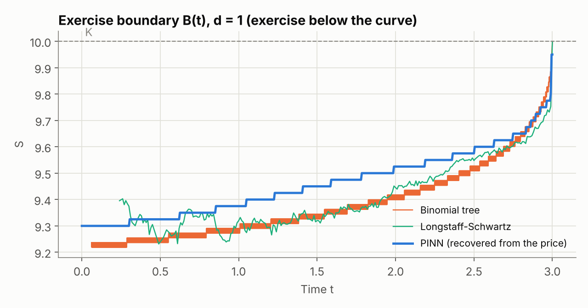
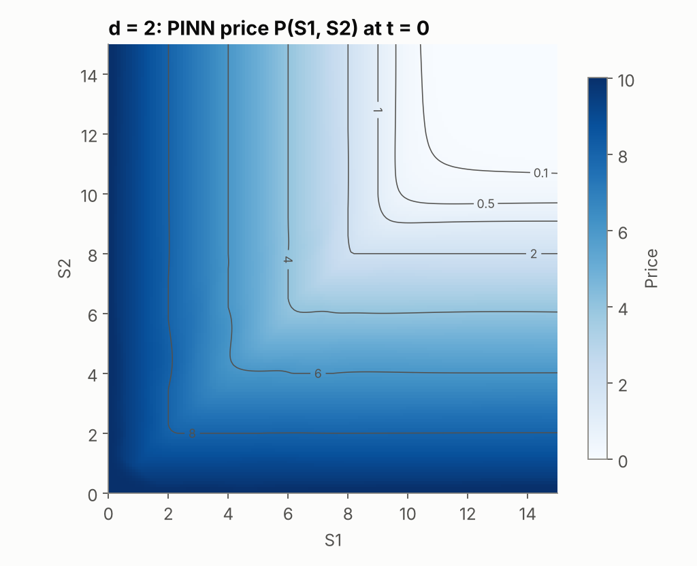
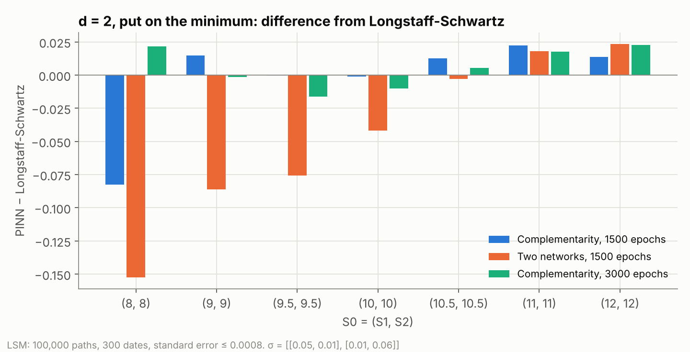

# Physics-Informed Neural Networks for American option pricing

Master's thesis project by **Alberto Oliva Medin**.

A Physics-Informed Neural Network (PINN), written in **C++ with LibTorch**, that prices American options,
including the American put on the minimum of several underlyings. The network does not learn from
data: it learns directly from the Black-Scholes equation with the early-exercise constraint.
The prices are validated against a **binomial tree** and **Longstaff-Schwartz Monte Carlo**, implemented
in Java. Two **Streamlit** interfaces launch the programs and show prices, tables and charts.

<p align="center"></p>

## The idea in one formula

The price P(S, t) of an American put with payoff ψ(S) = (K − min S)⁺ solves the linear
complementarity problem

```
Λ P ≤ 0,    P − ψ ≥ 0,    Λ P · (P − ψ) = 0
Λ P = ∂P/∂t + ½ Σᵢⱼ (σσᵀ)ᵢⱼ Sᵢ Sⱼ ∂²P/∂Sᵢ∂Sⱼ + Σᵢ (r − qᵢ) Sᵢ ∂P/∂Sᵢ − r P
```

In every point either the Black-Scholes equation holds (continuation, ΛP = 0) or the price equals the
payoff (exercise, P = ψ). The three conditions are the single equation **min(−ΛP, P − ψ) = 0**, which
becomes the loss of the network on all the collocation points:

```
L = mean[ min(−ΛP, P − ψ)² ]  +  L_terminal  +  L_boundary
```

The network never needs to know where the exercise boundary is. After the training the boundary is
recovered from the price, B(t) = max{ S ∈ [0, K] : P(S, t) − ψ(S) ≤ 10⁻³ }, and value matching and
smooth pasting follow from the formulation instead of being imposed.

The program also implements the **free-boundary formulation with two networks** (one for the price, one
for the boundary B(t)), the starting point of the project. Comparing the two is the main result below.

## Results

Put with K = 10, T = 3, r = 0.01, q = 0; PINN with seed 5 and 1500 epochs; references: binomial tree
(Cox-Ross-Rubinstein, 2000 steps) and Longstaff-Schwartz (100,000 paths, 300 exercise dates).

**One underlying (σ = 0.05)**

| S0 | PINN | Binomial tree | Longstaff-Schwartz | European put |
|---|---|---|---|---|
| 8 | 2.0000 | 2.0000 | 2.0000 | 1.7079 |
| 9 | 1.0000 | 1.0000 | 1.0000 | 0.7902 |
| 9.5 | 0.5318 | 0.5329 | 0.5326 | 0.4438 |
| 10 | **0.2439** | 0.2428 | 0.2436 | 0.2127 |
| 10.5 | 0.0978 | 0.0952 | 0.0945 | 0.0862 |
| 11 | 0.0345 | 0.0319 | 0.0320 | 0.0296 |
| 12 | 0.0024 | 0.0023 | 0.0023 | 0.0022 |

The largest difference from the tree is 0.0026; at the money it is +0.4%. The exercise boundary recovered
from the price starts at B(0) = 9.30 (tree: 9.22) and rises to K at maturity.

<p align="center"></p>

**Two underlyings, put on the minimum (σ = [[0.05, 0.01], [0.01, 0.06]])**

Near the strike the PINN agrees with Longstaff-Schwartz within the Monte Carlo standard error
(at (10, 10): 0.4308 against 0.4317 ± 0.0008); far from the strike the error grows.

<p align="center"></p>

**Lower loss does not mean a better price**

| Case | Formulation | Test-set loss | Price error at S = K |
|---|---|---|---|
| 1D | two networks | **3.7 · 10⁻⁴** | −9.4% |
| 1D | complementarity | 1.0 · 10⁻² | **+0.4%** |
| 2D | two networks | **0.0027** | −9.6% |
| 2D | complementarity | 0.359 | **−0.2%** |

With two networks the losses are much lower, but the two networks agree on an exercise boundary that is
too low (B(0) = 6.31 instead of 9.22 in 1D), and the price loses most of the early-exercise premium:
in 2D it even falls below the European put. The complementarity formulation has higher losses and the
right price. A PINN for American options has to be judged by its prices against independent references,
not only by its loss.

<p align="center"></p>

## Repository structure

The project uses three languages, each for what it does best.

**1. Java: reference prices (`Java_Project`)**

The Java code computes the prices that the PINN is compared with.

- **Naive Monte Carlo.** The simplest method: on every simulated path the option is exercised as soon as
  it is in the money. This rule is easy but not optimal, so the price it gives is too low.
- **Longstaff-Schwartz Monte Carlo (LSM).** At each exercise date, a linear regression on all the
  simulated paths estimates the continuation value, i.e. what the option is worth if it is kept.
  The option is exercised only when the immediate payoff is higher than this estimate. The regression
  "learns" the exercise rule from the paths, so LSM finds a much better exercise time. Its price is a
  lower bound, so it slightly underestimates the true value, but it is close to it.
- **Binomial tree (Cox-Ross-Rubinstein).** Deterministic and without statistical noise: it is the
  benchmark for one underlying. With several underlyings there is no binomial tree in this project, so
  the PINN is compared only with Longstaff-Schwartz.

**2. C++: the PINN (`C++_Project`)**

The PINN is written in C++ with LibTorch. The first version was written in Java with SameDiff
(Deeplearning4j), but it was too slow for this problem. In Java every tensor operation goes through
the JVM before reaching the native library that does the computation. The PINN needs many of these
operations, including the second derivatives of the network at every training step. In C++ the program
calls LibTorch directly and is compiled straight to machine code, and in my tests it was much faster.

**3. Python: interfaces and charts (`Charts_python_PINN`, `Charts_python_MonteCarlo`)**

Python is only the bridge between the user and the computation. The two Streamlit interfaces let you
choose the parameters, launch the C++ PINN and the Java Monte Carlo pricer, and follow the training while
it runs. At the end they show the prices, the tables and the charts used to check that the run worked
(losses, exercise boundary, price surface, comparison with the references).


## How do I run it?

**1. Languages and libraries**

You need C++, Java and Python. The main libraries are LibTorch for C++ and Streamlit for Python.
The Java code uses almost only standard Java, with no external libraries.

**2. IDE**

I suggest Visual Studio Code, the easiest one.

**3. Steps**

Download the repository as a ZIP, unzip it and open the folder in VS Code. Then open the terminal in
VS Code and:

1. Build the C++ code (only the first time):
   ```
   cd "path/to/PINN-for-American-Option/C++_Project"
   cmake -S . -B build
   cmake --build build --config Release
   ```
2. Go to the interface folder and run it:
   ```
   cd "path/to/PINN-for-American-Option/Charts_python_PINN"
   python -m pip install -r requirements.txt
   python -m streamlit run app.py
   ```
   For the Monte Carlo interface, do the same in `Charts_python_MonteCarlo`.

The page opens in the browser.

### Note on LibTorch

LibTorch is the only part that takes a bit more work. Download it from
[pytorch.org](https://pytorch.org/get-started/locally/) (LibTorch, CPU, Release) and unzip it in
`C:/libtorch`. If you put it somewhere else, change the line `set(CMAKE_PREFIX_PATH "C:/libtorch")`
in `C++_Project/CMakeLists.txt`.


## Reference

The two-network formulation reproduces the PINN of:

F. Gatta, V. Schiano Di Cola, F. Giampaolo, F. Piccialli, S. Cuomo,
*Meshless methods for American option pricing through Physics-Informed Neural Networks*,
Engineering Analysis with Boundary Elements 151 (2023) 68–82.

The complementarity formulation, the C++/LibTorch implementation, the validation against the binomial
tree and Longstaff-Schwartz, and the interfaces are my own work.


**Have fun testing the project!!!**

My contact 
alberto.casaolmed@gmail.com


